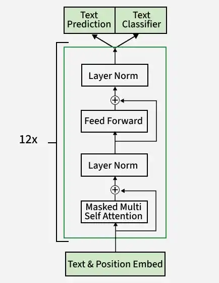

# Key Gen AI Models:
Some of the important gen AI models are:
GPT,DALL-E,Codex.

### Generative Pre-trained Transformer(GPT):
GPT models are based on the transformer architecture, but unlike traditional transformer architecture, GPT is a decoder-only architecture.
A decoder-only transformer eliminates the encoder component and directly generates output from input, which simplifies the architecture while maintaining powerful sequence modeling capabilities.
The defining characteristic of GPT's decoder blocks is the masked(causal) self-attention, which ensures each position can attend to itself and previous positions, not future positions.

### DALL-E:
DALL-E is a neural-network based picture generating system. It utilizes a modified version of GPT-3 architecture.
Since GPT-3 relies on the Transformer architecture, a neural network design known for its efficacy in handling sequences, it empowers DALL-E to understand and process textual descriptions efficiently.
DALL-E is trained using vast datasets containing text-image pairs, so the model learns relationships between textual descriptions and images corresponding to that text.
Once the model is trained with the data, DALL-E can take input and predict the image that is corresponding to that, by checking the relationships it has learned and applying them.

### Stable Diffusion:
Stable diffusion is a technique used in generative artificial intelligence, particularly in the context of image generation.
It is an extension of diffusion probabilistic model which is used for image generation.
The model operates in a latent space, significantly reducing computational requirements compared to pixel-based models.
Stable diffusion employs a diffusion process that progressively adds and removes Gaussian noise to and from an image. The process involves the several key components:
- Variational Autoencoder(VAE): Compresses images into a latent space for efficient processing and reconstructs them back into full resolution.
- Forward and Reverse Diffusion: Forward diffusion add noise to images, while reverse diffusion iteratively removes noise to generate realistic outputs.
- Noise Predictor (U-Net): A neural network that estimates and subtracts noise during the reverse diffusion process.
- Text Conditioning: Uses textual prompts to guide the generation process, embedding prompts into vectors that influence the final output.

### Codex:
Codex is an AI coding agent that can write features, fix bugs, answer questions about user's codebase.
The system has 3 main layers: the agent loop, prompt and context management, and the multi-surface architecture that lets one agent serve many different interfaces.

