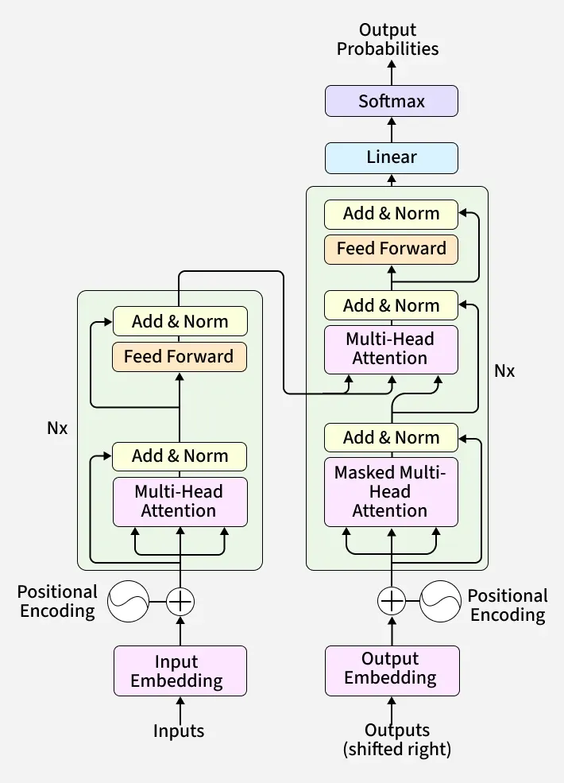

# Transformers
Transformer is a deep-learning model that can process sequences. The architecture : 

## The core concepts of Transformers : 
### - Self-Attention : 
This mechanism allows transformers to understand which words in the sentence are relevant to each other or, in other words, it enables the model to learn about context. Let us look at two sentences : 
1) The bank of the river
2) The money in the bank

In both these sentences the word "bank" appears but the definition of that word is different. To let the model understand this difference, the attention is important.

This is done using a scaled dot-product approach as shown below:

Each word/token in a sequence is converted to three vectors: Query(Q), Key(K), Value(V).

The attention score is computed as:

*Attention(Q,K,V) = softmax(QKT/√dk)V*; 

where dk is the dimensionality of the vectors.

These attention scores determine how much attention should each word pay to others. 

### Multi-head Attention:
Instead of running only one attention mechanism, transformers use multiple attention heads in parallel. Each head captures different relationships or patterns in the data, enriching the model's understanding.

### Positional Encoding:
Transformers need to understand the word ordering as they process the entire text in parallel. This problem is solved by adding Positional Encodings to the token embeddings which provides information about the postion of each token within a sequence.

The most common ways of computing the positional embedding is based on sinusoidal calculations.

For each position(pos) in the sequence and each dimension i in the positional encoding vector the formula used are:

Even-indexed dimensions: PE(pos,2i) = sin(pos/100002i/dmodel )

Odd -indexed dimensions: PE(pos,2i+1) = cos(pos/100002i/dmodel )

where:

- PE(pos, 2i): The positional encoding at position pos for the 2i-th dimension.
- pos: The position of the token in the sequence, usually starting from 0.
- i: The index used to determine the pair of dimensions 2i and 2i+1.
- dmodel: The dimensionality of the model, such as 512 or 1024.
- 10000(2i/dmodel): Controls how the frequency of the sine and cosine functions changes across dimensions.

### Feed-Forward Network:
Self attention helps the model to learn about context, while the Feed-forward layer takes the output of the self-attention layer and captures more intricate patterns in the data by applying non-linearity on the context-aware data.

### Encoder : 
The primary work of the encoder is to read an entire input sequence at once, analyze it bidirectionally and convert it into a context-aware numerical representations. Since Encoder is mainly used to understand texts, encoder-only models (like BERT) can be used for text classification and sentiment analysis.

### Decoder :
The decoder is responsible for generating the output sequences one token at time in an autoregressive manner. So decoder generates token sequentially and at every step it feeds the previously generated tokens back into itself to generate the next token. This process continues until a special [end] token is generated by the model.

