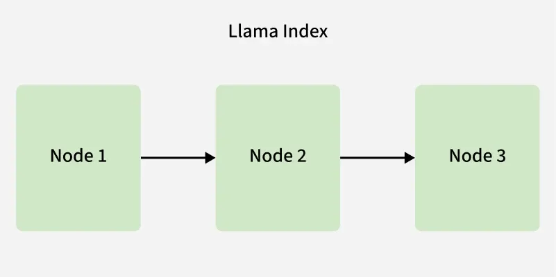
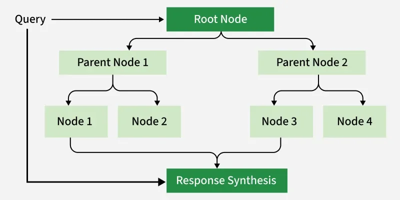
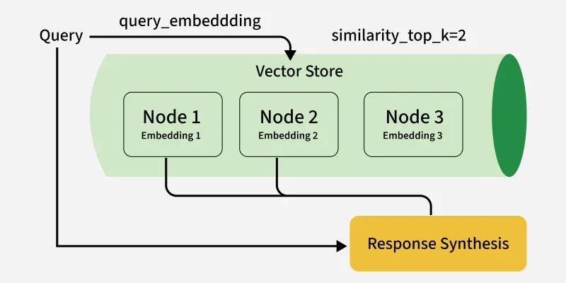
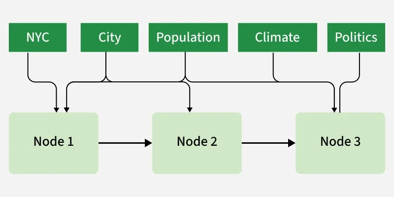

# LlamaIndex
LlamaIndex is an open-source framework that helps to connect private and domain-specific data to LLMs. It simplifies data indexing, ingestion, querying for much better and efficient outputs.

1) Data Ingestion - It supports data loading from various sources like APIs, databases, PDFs, spreadsheets and more.
2) Indexing - It converts raw data into structured formats for fast and accurate retrieval, with different index types for different needs like: 

    - List Index - Organizes data sequentially, ideal for working with ordered or evolving datasets like logs or time series information. 
    
    - Tree Index - Structures the nested or complex data hierarchically using a binary tree format.
    
    - Vector Store Index - Converts documents into vector embeddings that capture sematic relationships between words, enabling similarity search and helping the model to retrieve relevant information.
    
    - Keyword Index - Maps metadata tags or keywords to specific data nodes, optimizing retrieval for keyword driven queries over large dataset.
    
    - Composite Index - Combines multiple indexing strategies to balance query performance and precision.

3) Querying - LlamaIndex allows users to query using natural langage, where system interprets the query and retrieves relevant information.
