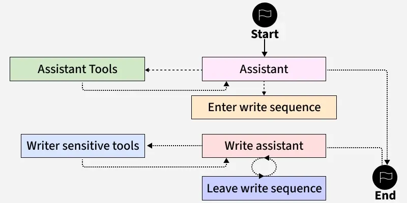

# LangChain
Langchain is an open-source framework for building application powered by Large Language Models(LLMs). It connects LLMs to data sources, memory, tools and external APIs.

Raw LLMs lack memory and ability to take real-world actions, so Langchain acts as the connective layer between an LLM and everything else an application needs.

## LangChain's architecture:
The architecture has six core components:
1) Models - LangChain provide a standard interface for working with virtually any LLM. So developers can swap between GPT, Claude, Gemini, Llama or any other open-source model with minimal code changes.

2) Prompt Templates - Langchain's PromptTemplate class lets you define reusable prompt structures with placeholders. Developers fill in the placeholders at runtime based on user's input or other context, making prompt management cleaner, testable and easier to maintain.

3) Chains - A chain connects multiple components together in a sequence. A simple chain can be: take a user's question, format it into a prompt template, send it to an LLM and parse the response.

4) Memory - Memory modules let your application remember previous interactions. 

5) Agents - AI Agents are LLM-powered components that decide what action to take based on user input and available tools. Instead of following a fixed workflow, an agent reasons about what to do next based on what the user is asking. Example : Agent might decide to query a database or run a calculation if the answer to the user query requires so.

6) Tools and Tool Integration - Tools are the capabilities given to the agents. LangChain has built-in integrations for hundreds of tools including web search, code interpreters, SQL databases, third-party APIs.

# LangGraph
LangGraph, created by LangChain, is an open-source AI Agent framework designed to build, deploy and manage complex generative AI agent workflows. At its core, LangGraph uses the power of graph-based architectures to model and manage the relationships between various components of an AI agent workflow.

- Start - The process begins with the agent initiating a task.
- Assistant - This is the central node managing the overall workflow, by controlling the movement between tools and sequences based on the current side.
- Enter Write Sequence - If task requires writng assisstance like generating content, the workflow enters a dedicated writing sequence.
- Write Assistant - This module focuses on writing porcess. It may loop with tools to refine or edit before completing the sequence.
- Leave Write Sequence - Once the writing task is complete the system exits the write mode.
- Writer Sensitive Tools and Assistant Tools - These nodes provide specialized capabilities. Depending on the state the Assistant routes tasks to tools that enhance writng or perform sensitive operations.
- End - The process concludes once the desird outcome is achieved and all necessary tools have been executed.

# Difference between Langchain and LangGraph
LangChain uses a straight-forward step-by-step pipeline where each task follows a fixed sequence from input to output while LangGraph allows flexible workflows with branching and parallel steps, making it better suited for complex, decision-based applications.

